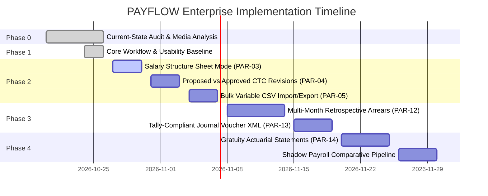

# PAYFLOW — Phased Implementation Roadmap: Enterprise Evolution

**Document Reference**: `docs/PAYFLOW_IMPLEMENTATION_ROADMAP.md`  
**Execution Timestamp**: `2026-10-26T12:15:00+05:30`  
**Platform**: PAYFLOW Enterprise Payroll System  
**Auditor**: Principal Payroll Product Architect  
**Status**: `APPROVED & BASELINED`

---

## 1. Executive Strategy

The PAYFLOW evolution follows a strict, controlled multi-phase engineering plan designed to deliver enterprise features inspired by Spine HRNG and Saral PayPack without destabilizing the verified working baseline (289/289 passing tests, 0 build errors).

### Roadmap Guardrails:
1. **Preserve Working Code**: Zero regression in the existing 7-stage engine, AST formula parser, TDS studio, or RBAC security.
2. **Database Isolation**: No drops, truncations, or schema rewrites on `payroll_management`.
3. **Decoupled Verification**: Every phase must conclude with unit tests, integration tests, TypeScript type checks, and frontend production build verification.
4. **Maker-Checker Segregation**: Financial operations must strictly maintain segregation of duties.

---

## 2. Multi-Phase Implementation Plan

---

### Phase 0: Discovery, Architecture Audit & Media Analysis
- **Status**: `COMPLETED & VERIFIED`
- **Scope**:
  - Full codebase inspection across frontend, backend, Prisma models, and test suites.
  - Video and screenshot extraction for Spine HRNG and Saral PayPack reference workflows.
  - Verification of database isolation (`payroll_management` vs `payroll_management_test`).
  - Production of `PAYFLOW_CURRENT_STATE_AUDIT.md` and `PAYFLOW_FEATURE_PARITY_MATRIX.md`.

---

### Phase 1: Core Foundation & Workflow Usability Verification
- **Status**: `COMPLETED & VERIFIED`
- **Scope**:
  - Validation of 7-Stage Payroll Engine (`DRAFT` to `PAID`).
  - Monthly Salary Editor parity (`Entry` vs `Calculation` dual modes).
  - TDS Tax Studio multi-regime assessment and automated porting.
  - Granular RBAC dynamic UI element hiding and permission management.
  - Expenses & Reimbursements workflow separation with receipt base64 storage.
- **Verification Evidence**: 15 test suites passed (289/289 tests), Vite build transformed 1,948 modules with 0 errors.

---

### Phase 2: Advanced Salary Structure & Bulk Variable Operations
- **Status**: `READY FOR IMPLEMENTATION (QUEUED)`
- **Target Work Packages**:

#### Package 2.1: Salary Structure Sheet Mode Spreadsheet View (`PAR-03`)
- **Reference**: Spine Salary Structure 4-Column Sheet Mode (`image.png`).
- **Goal**: Add a 4-column balanced ledger view (Allowances, Deductions, Variables, Attendance/Others) inside [`CompensationView.tsx`](file:///c:/Users/Ashutosh%20Pandey/Downloads/payroll-management-system/frontend/src/pages/CompensationView.tsx) with side-by-side comparison with previous revision.
- **Acceptance Criteria**:
  - Fast keyboard navigation across salary components.
  - Real-time annual CTC vs monthly gross recalculation.
  - Visual delta tags showing differences compared to current active structure.
- **Tests Required**: Frontend component rendering tests and revision comparison utility unit tests.

#### Package 2.2: Proposed vs Approved CTC Structure Lifecycle (`PAR-04`)
- **Reference**: Spine Approved vs Proposed Salary Structure workflows.
- **Goal**: Introduce a formal Maker-Checker lifecycle (`PROPOSED` -> `APPROVED` -> `ACTIVE`) for employee salary revisions before they can be consumed by active payroll batches.
- **Acceptance Criteria**:
  - HR Manager creates a proposed revision with an effective date.
  - Finance Director or authorized Checker reviews the delta and approves/rejects with comments.
  - Locked historical payroll runs are never altered by retroactive revisions.
- **Tests Required**: Backend API tests verifying state transitions, SOD enforcement, and historical immutability.

#### Package 2.3: Bulk Variable CSV Import/Export (`PAR-05`)
- **Reference**: Saral PayPack Monthly Salary Editor bulk operations.
- **Goal**: Provide downloadable pre-populated CSV templates and validation import for variable adjustments (overtime hours, incentives, bonus, special deductions) in [`MonthlySalaryEditorModal.tsx`](file:///c:/Users/Ashutosh%20Pandey/Downloads/payroll-management-system/frontend/src/components/MonthlySalaryEditorModal.tsx).
- **Acceptance Criteria**:
  - Export CSV pre-filled with active employee IDs, names, and current adjustment columns.
  - Import parses CSV, validates numbers, flags negative or invalid values per row, and previews changes.
  - Reject corrupted rows while importing valid records with an error summary.
- **Tests Required**: CSV parser unit tests, boundary condition tests, and integration tests on `/runs/:id/adjustments`.

---

### Phase 3: Multi-Period Arrears Engine & Financial Integrations
- **Status**: `QUEUED (DEPENDENT ON PHASE 2)`
- **Target Work Packages**:

#### Package 3.1: Multi-Month Retrospective Arrears Engine (`PAR-12`)
- **Reference**: Spine Run Arrears (`Screenshot 2026-10-26 104248.png`).
- **Goal**: Implement a multi-month retrospective arrears calculation pipeline.
- **Acceptance Criteria**:
  - User selects `From Month/Year`, `To Month/Year`, and `Pay-in Month/Year`.
  - Engine fetches historical locked payslips, evaluates revised salary structures across each historical month, and calculates the delta per component.
  - Arrears lines are itemized and attached to the target pay-in payroll run.
  - Duplicate arrears runs for the same period and employee revision are strictly blocked.
- **Tests Required**: Multi-month recalculation accuracy tests, edge-case tax tests, and duplicate prevention tests.

#### Package 3.2: Tally-Compliant Journal Voucher XML Export (`PAR-13`)
- **Reference**: Spine Financial Reports Journal Voucher & Tally Export.
- **Goal**: Export double-entry accounting journal vouchers conforming to Tally XML schema.
- **Acceptance Criteria**:
  - Organization can map earnings, deductions, and liabilities to General Ledger (GL) account codes.
  - Total debits (Gross Salaries, Employer PF, Employer ESI) exactly match total credits (Net Pay Payable, Employee PF, ESI, TDS, Loan Repayments).
  - Validated XML schema export download ready for direct ingestion in Tally Prime / ERP 9.
- **Tests Required**: Balanced ledger arithmetic assertions and XML schema validation tests.

---

### Phase 4: Gratuity Statements, Shadow Payroll & Enterprise Governance
- **Status**: `BLOCKED BY BUSINESS POLICY (PENDING CORPORATE RATIFICATION)`
- **Target Work Packages**:

#### Package 4.1: Gratuity Actuarial Statement & Exit Payout (`PAR-14`)
- **Reference**: Spine Gratuity Master & Payment of Gratuity Act, 1972.
- **Scope**: Formal calculation statement upon employee offboarding: `(15 * Last Drawn Basic * Continuous Years of Service) / 26`.
- **Policy Blocker**: Requires corporate legal signoff on forfeiture conditions (moral turpitude clauses) and maximum cap limits (currently ₹20 Lakhs).

#### Package 4.2: Automated Shadow Payroll Verification Runner
- **Scope**: Parallel calculation engine comparing PAYFLOW outputs against existing legacy payroll reports with variance heatmaps.

---

## 3. Risk Mitigation & Quality Control Gate

| Risk Area | Mitigation Strategy | Enforcing Control |
|:---|:---|:---|
| **Database Corruption** | Strict isolation between `payroll_management` and `payroll_management_test`. | [`backend/tests/setup.ts`](file:///c:/Users/Ashutosh%20Pandey/Downloads/payroll-management-system/backend/tests/setup.ts) environment checks |
| **Rounding Drift** | All monetary calculations use `Decimal.js` with exact 2-decimal rounding. | AstFormulaEngine precision tests |
| **Unauthorized Overrides** | Enforce Segregation of Duties (Maker cannot be Checker). | `requireRole` & `validateSOD` middleware |
| **Test Failures** | Zero-tolerance policy on test failures; automated regression before every phase completion. | Pre-commit Vitest & Vite build gates |
