# PAYFLOW — Comprehensive Reference Analysis: Spine HRNG & Saral PayPack

**Document Reference**: `docs/PAYFLOW_REFERENCE_ANALYSIS.md`  
**Execution Timestamp**: `2026-10-26T12:15:00+05:30`  
**Auditor**: Principal Payroll Product Architect & Indian Payroll Domain Specialist  
**Status**: `VERIFIED & AUDITED`

---

## 1. Executive Summary & Purpose

This document provides a detailed, evidence-based functional and workflow analysis of the user-provided reference systems:
1. **Spine HRNG / Spine Payroll** (Screenshots & Demonstration Video)
2. **Saral PayPack** (Demonstration Video & Feature Guides)
3. **Open ERP Payroll Reference** (Demonstration Video)

The objective of this analysis is to extract battle-tested Indian corporate payroll operational patterns, configuration capabilities, and workflow ergonomics without copying proprietary source code, branding, or copyrighted visual assets. PAYFLOW incorporates these validated workflows into its existing modern TypeScript, React, Express, Prisma, and PostgreSQL stack.

---

## 2. Reference Media Inventory & Inspection Evidence

### 2.1 Video Media Analysis

| Identifier | Source Video File | Duration | Format & Resolution | Key Workflows Demonstrated | PAYFLOW Architectural Mapping |
|:---|:---|:---:|:---:|:---|:---|
| **VID-01** | `A Guide On March End Salary Processing with Spine HR Suite.mp4` | 686.61s (11m 26s) | H.264 / AAC, 640x360 @ 30fps | - March Year-End cutoff dates - Investment declaration verification - TDS computation recalculation & 80C/80D relief - Bonus & Annual Variable adjustments - Final March payroll lock and statutory porting | Mapped to PAYFLOW's 7-Stage Batch Engine (`PayrollProcessingView.tsx`) & TDS Tax Studio (`TdsTaxStudioModal.tsx`). PAYFLOW preserves year-end tax adjustment locks and porting mechanisms. |
| **VID-02** | `saral demo.mp4` | 410.23s (6m 50s) | VP9 / Opus, 640x342 @ 30fps | - Salary Master component setup - Monthly Salary Editor (Dual-mode: *Entry* vs *Calculation*) - Variable pay, LOP & overtime adjustments - Instant calculation preview card - Statutory withholdings (PF, ESI, PT, TDS) - Bulk slip generation | Mapped to PAYFLOW's `MonthlySalaryEditorModal.tsx` dual tab view (`Entry` mode with quick form vs `Calculation` mode with breakdown card) and AST formula validation. |
| **VID-03** | `salary-slip--attendance---how-to-build-a-full-hr--payroll-erp-with-google-apps-script-and-react.mp4` | 944.10s (15m 44s) | AV1 / Opus, 640x360 @ 30fps | - Attendance roster integration - Leave balances & LOP deduction derivation - Payslip generation with QR verification - Direct PDF slip download & secure employee portal - Automated bulk email dispatch | Mapped to PAYFLOW's `AttendanceView.tsx`, `LeaveView.tsx`, and `POST /runs/:id/send-payslips` with background Nodemailer queue. |

---

### 2.2 Screenshot Reference Inventory & Field-Level Extraction

| Screenshot File | Module / Screen Name | Demonstrated Capabilities & Fields | PAYFLOW Status & Gap Analysis |
|:---|:---|:---|:---|
| `Screenshot 2026-10-26 103128.png` `Screenshot 2026-10-26 103457.png` | **Spine Pay Code Master** | - Code, Head Name, Component Type (Earning, Deduction, Reimbursement) - Calculation Type (Fixed, AST Formula, Slab-based) - Calculation on Present Days (Proration toggle) - Attach As (Standard, Variable, One-time) - Rounding rule, Print Priority, Active toggle | **Fully Implemented**: PAYFLOW's [`ColumnMasterView.tsx`](file:///c:/Users/Ashutosh%20Pandey/Downloads/payroll-management-system/frontend/src/pages/ColumnMasterView.tsx) and backend `FormulaEngine` support all core attributes with AST syntax verification. |
| `Screenshot 2026-10-26 103522.png` `Screenshot 2026-10-26 103948.png` | **Spine 13-Module Menu Tree** | - Masters, Transactions, Salary Structure, Monthly Process, Arrears, TDS, Loans, Reimbursements, Reports, Utilities, Admin Security | **Implemented with Modern Navigation**: Instead of an intimidating legacy Windows 98 tree-view, PAYFLOW utilizes modern responsive sidebar navigation with dynamic RBAC visibility. |
| `Screenshot 2026-10-26 103612.png` | **Spine Summary Variables** | - Summary Code, Description - Past Year, Current Year, Payable in 12 Months selection - Aggregated financial tracking | **Partially Implemented**: Contextual aggregation exists in formula execution; dedicated GUI for configuring custom multi-month summary codes can be added to Column Master. |
| `Screenshot 2026-10-26 104145.png` | **Spine CTC General & Additional Filters** | - Multi-level drill-down: Company, Branch, Department, Designation, Division, Unit, Category, Project, Grade, Employee - Singular vs Tabular view selection | **Implemented & Filter-Enhanced**: PAYFLOW supports filtering across Company, Branch, Department, Designation, and Employee with instant live table search. |
| `Screenshot 2026-10-26 104248.png` | **Spine Run Arrears** | - From Month/Year, To Month/Year - Pay-in Month/Year - Historical vs Revised delta calculation - Segregation of arrears items | **Partially Implemented**: One-off Arrears adjustments are supported in the Monthly Salary Editor; dedicated multi-month retro batch engine queued for Phase 3. |
| `image.png` | **Spine Salary Structure Sheet Mode** | - 4-Column balanced ledger layout: Allowances, Deductions, Variables, Attendance/Others - Live compare against previous revision - Tabular rapid data entry | **Partially Implemented**: Template builder modal exists; adding a 4-column balanced ledger toggle directly in `CompensationView.tsx` will deliver complete workflow parity. |

---

## 3. Workflow Comparison: Reference vs. PAYFLOW

### 3.1 Monthly Salary Processing Lifecycle

```mermaid
graph TD
    subgraph "Spine / Saral Reference Workflow"
        S1[Select Month & Batch] --> S2[Input Adjustments & LOP]
        S2 --> S3[Process / Compute Batch]
        S3 --> S4[Manual Review & Lock]
        S4 --> S5[Single Click Disbursal & Slip Generation]
    end

    subgraph "PAYFLOW Enterprise 7-Stage Workflow"
        P1["1. DRAFT<br>(Initialize Period)"] --> P2["2. VALIDATED<br>(Attendance & Roster Checks)"]
        P2 --> P3["3. CALCULATED<br>(Decimal.js & AST Engine)"]
        P3 --> P4["4. REVIEWED<br>(Maker Review & Variance Flags)"]
        P4 --> P5["5. APPROVED<br>(Independent Checker SOD)"]
        P5 --> P6["6. PAYMENT_READY<br>(Bank NEFT Advice Generated)"]
        P6 --> P7["7. PAID<br>(UTR Reference Recorded & Locked)"]
    end
```

**Key Architectural Advantage of PAYFLOW**:
- **Segregation of Duties (SOD)**: While reference desktop software often allows a single user to compute, approve, and disburse payroll, PAYFLOW strictly enforces that the user who drafted or calculated a batch *cannot* approve it.
- **Decoupled Payment Execution**: PAYFLOW separates calculation approval (Stage 5) from actual banking instruction generation (Stage 6) and bank settlement confirmation with UTR (Stage 7).

---

### 3.2 Monthly Salary Editor Usability (Saral Parity)

Saral PayPack's strongest usability feature is its dual-panel Monthly Salary Editor. PAYFLOW directly matches this in [`MonthlySalaryEditorModal.tsx`](file:///c:/Users/Ashutosh%20Pandey/Downloads/payroll-management-system/frontend/src/components/MonthlySalaryEditorModal.tsx):
1. **Entry Mode**: A clean, spreadsheet-friendly table listing employees with editable inputs for Paid Days, Loss of Pay (LOP), Overtime Hours, Variable Incentives, and Ad-hoc Deductions.
2. **Calculation Mode**: A side-by-side split screen showing real-time recalculated Earnings, Statutory Deductions (PF, ESI, Professional Tax), Income Tax (TDS), Loan EMI deductions, and Net Take-Home Pay.
3. **Financial Safeguard**: Inline warning alerts if take-home pay drops below the statutory 25% threshold (Minimum Wages Act protection).

---

### 3.3 Statutory Tax Compliance (TDS)

Both Spine and Saral feature dedicated Indian Income Tax calculation studios. PAYFLOW achieves complete parity with its **TDS Tax Studio** ([`TdsTaxStudioModal.tsx`](file:///c:/Users/Ashutosh%20Pandey/Downloads/payroll-management-system/frontend/src/components/TdsTaxStudioModal.tsx)):
- Multi-regime comparison: Old Tax Regime (with 80C, 80D, HRA exemptions) vs New Tax Regime (Section 115BAC flat slabs).
- Automatic Section 206AA penalty withholding (20% flat tax) when a valid PAN is missing.
- One-click statutory porting: Recalculated monthly TDS is automatically updated on the active payroll run via `POST /tds/port-to-salary`.

---

## 4. Key Gaps Identified for Phased Evolution

1. **Salary Structure Sheet Mode Spreadsheet View (`PAR-03`)**: Provide a 4-column balanced ledger view (Allowances, Deductions, Variables, Attendance/Others) inside `CompensationView.tsx` with side-by-side version comparison.
2. **Proposed vs Approved CTC Revisions (`PAR-04`)**: Introduce formal Maker-Checker approval for employee salary revisions before they become effective in payroll batches.
3. **Bulk Variable CSV Import/Export (`PAR-05`)**: Add bulk CSV export and validation import for monthly variables inside the Monthly Salary Editor.
4. **Multi-Month Retrospective Arrears Engine (`PAR-12`)**: Build an automated engine that computes difference amounts when an increment is granted retroactively across previously locked payroll periods.
5. **Tally-Compliant Journal Voucher XML Export (`PAR-13`)**: Provide an automated accounting voucher export conforming to Tally XML schema with configurable GL account mapping.

---

## 5. Architectural Non-Negotiables

1. **No Framework Replacement**: Maintain React 19, Vite, Express, Prisma, and PostgreSQL.
2. **No Proprietary Code Copying**: All implementations are original PAYFLOW components and services.
3. **Preserve Database Isolation**: Main DB `payroll_management` remains untouched during testing; all test mutations run in `payroll_management_test`.
4. **Exact Precision**: Continue using `Decimal.js` for all financial computations to eliminate IEEE-754 floating point drift.
