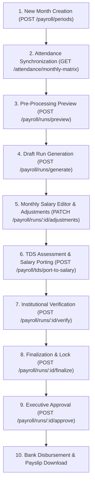

# PayFlow HRMS & Payroll ERP — Monthly Payroll Workflow

## 1. Executive Summary
This document provides the end-to-end operational guide and technical specification for PayFlow's monthly payroll workflow, demonstrating functional parity with the Saral PayPack enterprise reference standard while maintaining PayFlow's multi-tenant institutional governance architecture.

---

## 2. End-to-End Workflow Stages



---

## 3. Detailed Stage Breakdown

### Stage 1: Month / Period Creation (Saral Parity)
- **Endpoint**: `POST /api/v1/payroll/periods`
- **Role Requirement**: `payroll_pda`, `payroll_admin`, `super_admin`
- **Request Payload**:
  ```json
  {
    "month": 10,
    "year": 2026,
    "cutOffDay": 25,
    "payDay": 30
  }
  ```
- **Business Logic**:
  * Calculates `startDate` (1st of month) and `endDate` (last day of month).
  * Automatically binds the period to the organization's active `FinancialYear`.
  * Enforces duplicate prevention: rejects redundant period creation within the same company and calendar cycle.

### Stage 2: Time, Attendance & Loss of Pay (LOP) Ledger
- **Endpoint**: `GET /api/v1/attendance/monthly-matrix?month=10&year=2026`
- **Business Logic**:
  * Evaluates daily biometric punches and approved leave requests.
  * Computes: $\text{Payable Days} = \text{Calendar Days} - \text{Loss of Pay (LOP) Days}$.
  * Aggregates Overtime (OT) hours and Paid Leaves (CL, SL, PL, EL).
  * Exportable to CSV for institutional audit records.

### Stage 3: Pre-Calculation Preview
- **Endpoint**: `POST /api/v1/payroll/runs/preview`
- **Payload**: `{ "periodId": "period-uuid" }`
- **Business Logic**:
  * Runs dry-run AST evaluation on all active salary components and formulas.
  * Outputs projected Gross, Statutory Deductions, and Net Pay totals without writing records to the database.

### Stage 4: Institutional Run Generation
- **Endpoint**: `POST /api/v1/payroll/runs/generate`
- **Payload**: `{ "periodId": "period-uuid", "remarks": "Regular monthly pay run" }`
- **Business Logic**:
  * Creates `PayrollRun` in `GENERATED` status.
  * Creates individual `PayrollRecord` and `CorporatePayrollSlip` rows for each eligible staff member.
  * Freezes base earnings, allowances, and statutory deductions.

### Stage 5: Monthly Salary Editor & Adjustments (Saral Parity)
- **Endpoint**: `GET /api/v1/payroll/runs/:id/editor` & `PATCH /api/v1/payroll/runs/:id/adjustments`
- **Payload**:
  ```json
  {
    "adjustments": [
      {
        "employeeId": "emp-uuid-1",
        "variablePay": 5000,
        "arrears": 2500,
        "lopDays": 1.0
      }
    ]
  }
  ```
- **Saral PayPack Statutory Safeguard**:
  * Computes `isNetLessThan25Percent`: $\text{Gross} > 0 \land \text{Net} < (\text{Gross} \times 0.25)$.
  * Renders a blue compliance badge warning payroll officers against unlawful excessive deductions before authorization.

### Stage 6: TDS Assessment & Statutory Salary Porting (Saral Parity)
- **Endpoint**: `GET /api/v1/payroll/tds/summary?periodId=...` & `POST /api/v1/payroll/tds/port-to-salary`
- **Business Logic**:
  * Calculates projected annual taxable income across Old and New tax regimes under Finance Act progressive slabs.
  * Computes monthly TDS installment: $\text{Monthly TDS} = \frac{\text{Net Annual Tax}}{12}$.
  * One-click porting writes `TDS` line items directly into active slips and adjusts run deduction totals in a single atomic transaction.

### Stage 7 to 9: Segregation of Duties (SOD) Verification, Finalization & Approval
1. **Verification (`payroll_pvo`)**: Performs line-by-line validation of pay rates and days.
2. **Finalization (`payroll_pfo`)**: Freezes payroll run calculations and seals adjustments.
3. **Approval (`payroll_ar_salary` / `finance_admin`)**: Grants executive authorization for bank disbursement.
- **Audit Logging**: Any rejection triggers the Return for Correction workflow (`POST /runs/:id/return`) requiring audit notes.

### Stage 10: Bank Disbursement & Payslip Distribution
- Authorized runs generate bank transfer registers and unlock individual employee payslips in Self-Service.
- Print-ready and downloadable PDF payslips include company seals, PAN, bank details, and component breakdowns.
